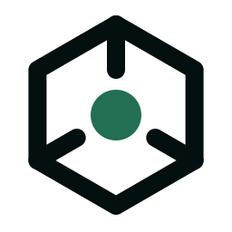
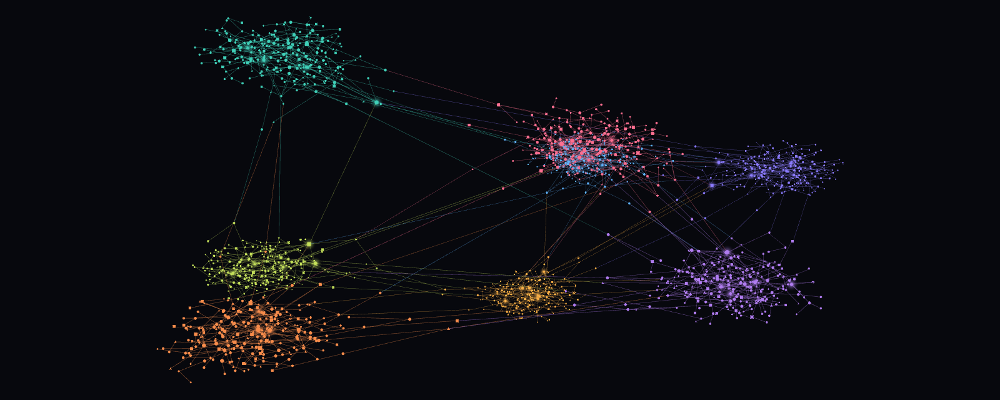
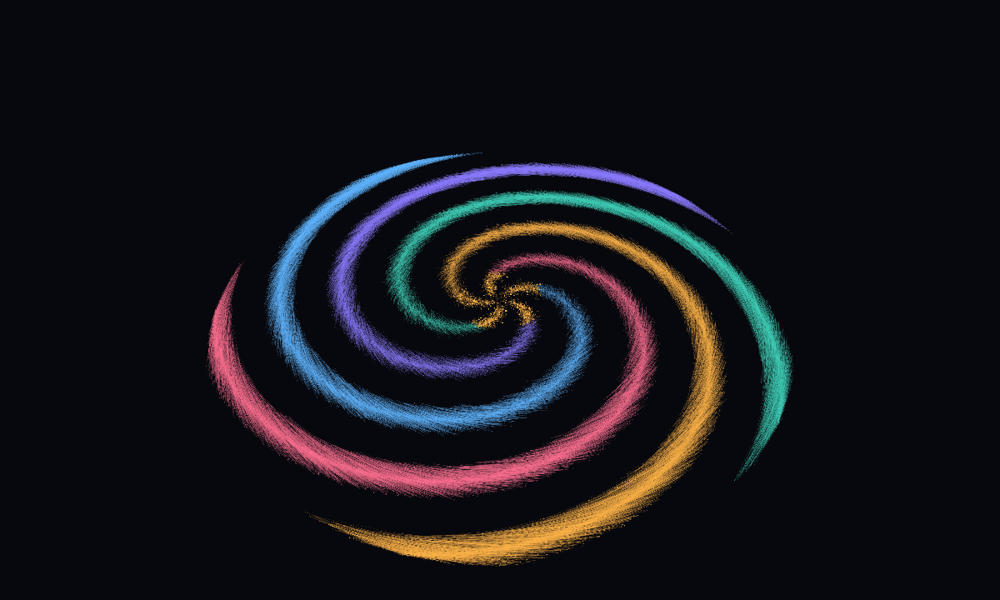
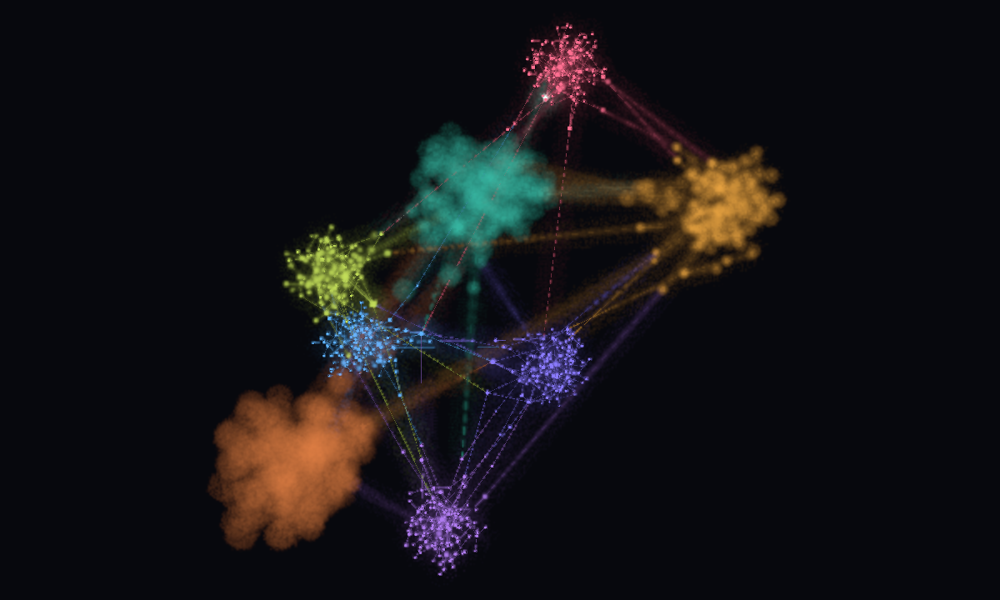
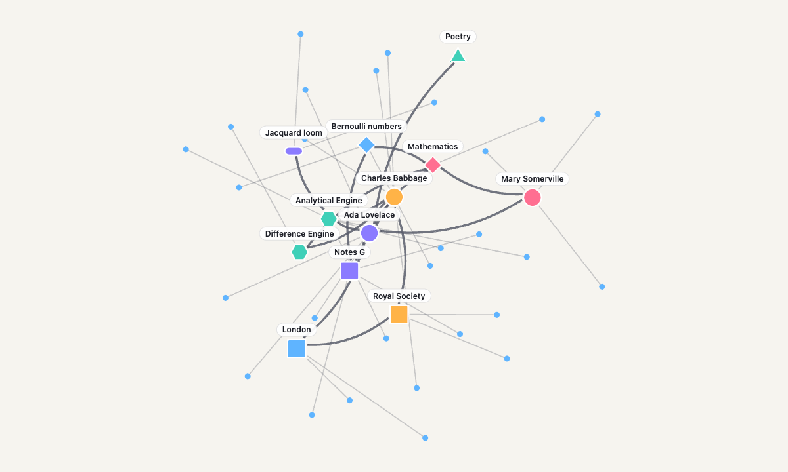
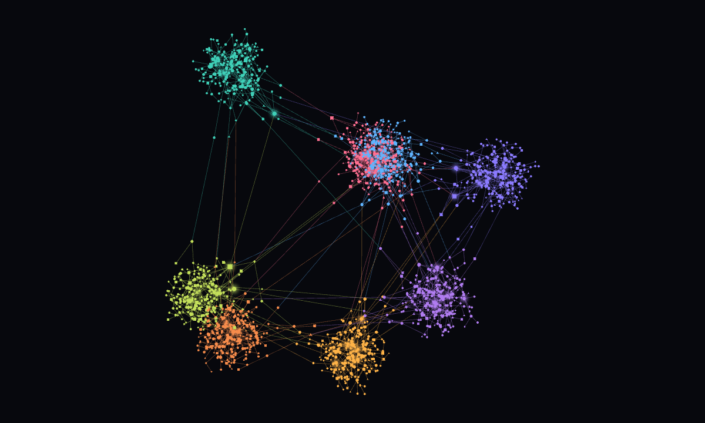

<p align="center">
  <picture>
    <source media="(prefers-color-scheme: dark)" srcset="./docs/src/assets/logo-dark.svg">
    
  </picture>
</p>

<h1 align="center">graphraum</h1>

<p align="center">
  <strong>Nodes. Edges. Space.</strong><br>
  A WebGL engine for interactive graphs in 2D and 3D, from ten nodes to a hundred thousand.
</p>

<p align="center">
  <a href="https://www.npmjs.com/package/@yggy-tech/graphraum"></a>
  <a href="https://github.com/yggy-tech/graphraum/actions/workflows/ci.yml"></a>
  <a href="./LICENSE"></a>
  <a href="https://yggy-tech.github.io/graphraum/"></a>
</p>

<p align="center">
  <a href="https://yggy-tech.github.io/graphraum/playground/"><b>Playground</b></a> ·
  <a href="https://yggy-tech.github.io/graphraum/">Documentation</a> ·
  <a href="https://yggy-tech.github.io/graphraum/reference/api/">API reference</a> ·
  <a href="./changelogs/">Changelog</a>
</p>

<p align="center">
  
</p>

graphraum draws graphs fast and stays out of your way. You bring the data and, if you like, the layout; graphraum renders it with one draw call for all nodes and one for all edges, picks what the pointer touches, and only renders when something changed. It has no framework inside, so it fits React, Svelte, Vue or plain TypeScript the same way.

> **Pre-1.0.** The API still moves while the rendering contracts are proven. Breaking changes are called out in the [changelog](./changelogs/).

## Quick start

```sh
npm install @yggy-tech/graphraum
```

```ts
import { computeForcePositions, Graphraum } from "@yggy-tech/graphraum";

const graph = new Graphraum(document.querySelector<HTMLElement>("#graph")!, { mode: "3d" });

graph.setData({
  nodes: [
    { id: "ada", position: { x: 0, y: 0, z: 0 }, color: "#8b7bff", size: 8 },
    { id: "engine", position: { x: 40, y: 10, z: -20 }, color: "#3fd0b8", shape: "hexagon" },
    { id: "notes", position: { x: -30, y: 25, z: 15 }, color: "#ffb347", shape: "square" },
  ],
  edges: [
    { id: "wrote", source: "ada", target: "notes", marker: "triangle" },
    { id: "about", source: "notes", target: "engine", path: "quadratic" },
  ],
});

// Click to select; the selection colours the node and its edges.
graph.onFocusChange(() => console.log(graph.getSelectedNodeIds()));
document.querySelector<HTMLElement>("#graph")!.addEventListener("click", (event) => {
  const id = graph.pick(event.clientX, event.clientY);
  graph.setSelection(id ? [id] : []);
});
```

No positions yet? Run the built-in force layout and hand the result over:

```ts
const positions = computeForcePositions({ dimensions: 3, nodeCount: 3, edges: new Uint32Array([0, 2, 2, 1]) });
graph.applyLayout({ nodeIds: ["ada", "engine", "notes"], positions });
```

## What it looks like

<table>
  <tr>
    <td width="50%"></td>
    <td width="50%"></td>
  </tr>
  <tr>
    <td><b>100,000 nodes, 100,000 edges.</b> Instanced nodes and batched edges keep large graphs interactive in a browser tab. Layout is an input: this galaxy is twenty lines of your own code.</td>
    <td><b>Depth of field.</b> In 3D the selection stays sharp and the rest of the graph blurs with its distance, in front and behind, like a camera lens. Off by default, free while off.</td>
  </tr>
  <tr>
    <td width="50%"></td>
    <td width="50%"></td>
  </tr>
  <tr>
    <td><b>Shapes, arrows, curves, labels.</b> Seven node shapes with strokes, solid, dashed and dotted edges, straight or curved, with arrowheads. Labels and cards are your own HTML on a bounded overlay.</td>
    <td><b>2D and 3D on one graph.</b> Switch with <code>setMode()</code> and keep the data, selection and styles. Orbit, auto-orbit, fly-to, glowing hubs and saved camera views come with it.</td>
  </tr>
</table>

## Features

- **Fast by construction.** One node draw, one edge draw, on-demand rendering, viewport culling and a density level of detail for million-node scenes. `getDiagnostics()` reports draw calls, frame time and what is visible.
- **Interaction built in.** Picking for nodes and edges, hover, selection, focus and dimming states, node dragging, `fitView()`, `flyTo()`, saved camera views.
- **Your layout or ours.** Pass any positions, stream them with `applyLayout()`, or use the force layout helpers with clusters and per-edge springs.
- **Typed visual mapping.** Map your own node and edge attributes to colour, size, shape, stroke, glow, dash, markers and curves with `defineVisuals()`.
- **HTML where it matters.** Labels, a toolbar and rich cards for a small focused set, budgeted so the dense graph stays on the GPU.
- **Themes.** Light and dark presets, partial overrides, solid, transparent or patterned backgrounds.
- **graphology ready.** `bindGraphology()` keeps a graphology graph and the renderer in sync.

## Why graphraum

- **Graph-native.** Nodes, edges, stable ids, positions and selection are the API, not meshes and materials.
- **2D first, 3D on the same state.** One graph, two cameras.
- **Layout is an input.** The renderer never runs hidden simulations.
- **No framework in the core.** Adapters live outside, so the hot path stays plain TypeScript.

## Contributing

Requires [Bun](https://bun.sh/).

```sh
bun install
bun run dev            # graph laboratory: every option, 100 to 100,000 nodes
bun run dev:showcase   # the scenes behind the images above (?scene=hero|focus|labels|scale)
bun run check          # Biome + TypeScript
bun run test
bun run build
```

Read [`AGENTS.md`](./AGENTS.md) for the engineering rules. Work starts from a [GitHub issue](https://github.com/yggy-tech/graphraum/issues); commits and PR titles follow [Conventional Commits](https://www.conventionalcommits.org/), because squash merges become release commits. semantic-release publishes to npm after CI passes on `main`.

The documentation site runs locally with `bun install --cwd docs && bun run docs:dev`.

## License

[Apache-2.0](./LICENSE)
